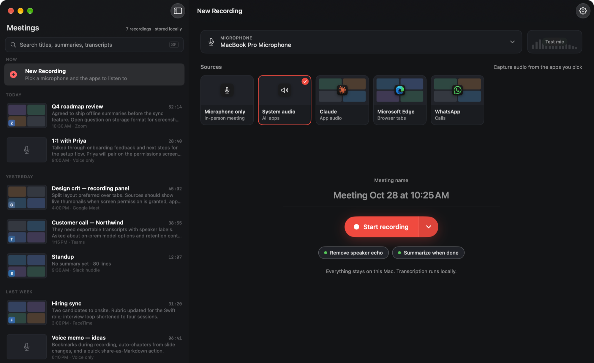
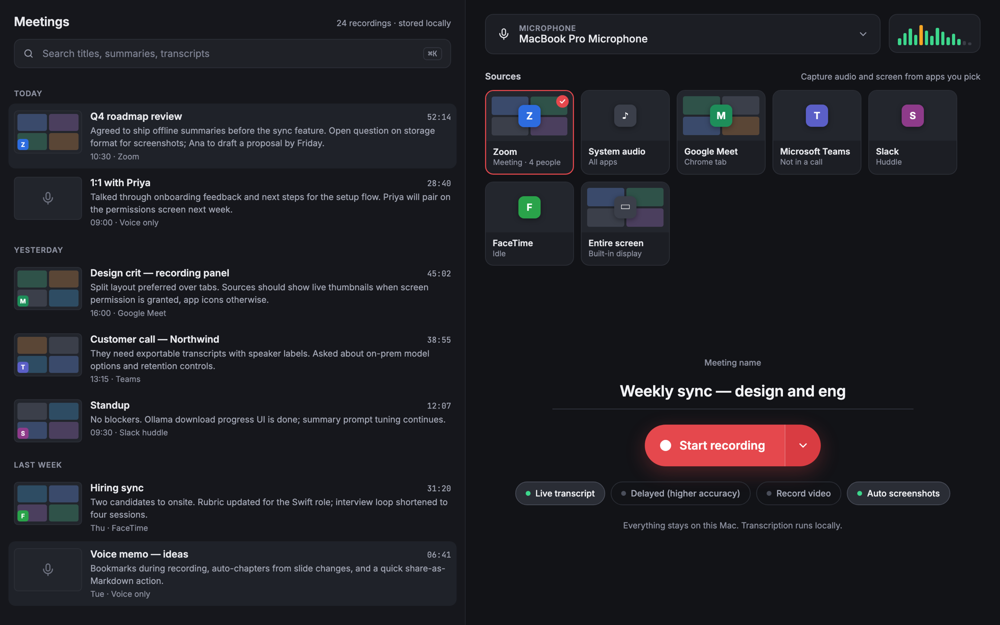
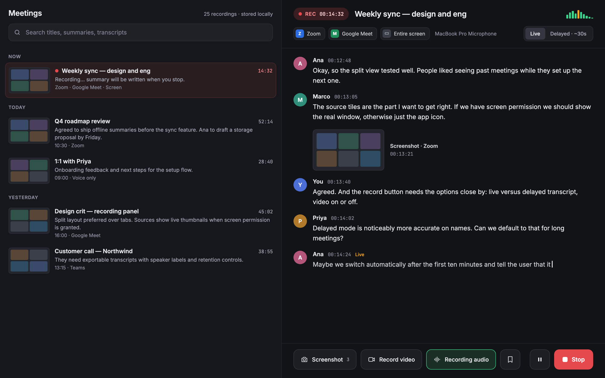

# Private Meeting Assistant

A native macOS app that transcribes your meetings live, then writes the summary, decisions and action items. Everything runs on your Mac, and every meeting is a folder of Markdown files you own.



## Why it exists

A use case for AI-assisted software development: a small, focused app, built largely by an AI coding agent, that removes a recurring software cost and solves real privacy problems.

- **Confidential meetings can't go to the cloud.** Board, executive and C-suite discussions often can't be uploaded to a third-party transcription service. Here, recording, transcription and summaries all run on the Mac, and nothing is uploaded.
- **One archive instead of several.** Meet, Zoom and Teams each keep their own recordings and transcripts, and in-person meetings usually aren't captured at all. This app records any of them the same way, into one searchable archive of plain files.
- **Built for strict privacy requirements.** Legal and HR teams need to control exactly where sensitive conversations are stored and who can reach them. Meetings stay in a folder you choose, as ordinary files you can keep on encrypted or managed storage, back up, or delete under your own retention rules.
- **No per-seat subscription.** Recording, transcription and AI summaries are usually paid add-ons or separate subscriptions, and across a company those can add up to thousands a year. This app uses free, open models running on Macs people already have.

- **Works with any call app** (Zoom, Meet, Teams, FaceTime, Slack, WhatsApp, in person). It records your microphone as **Me** and the call's audio directly, so no bot joins the meeting. Pick one app to listen to, all system audio, or the microphone only.
- **Tells speakers apart.** Each voice on the call gets its own label (Participant 1, 2…), and in-person recordings tell everyone in the room apart. When the recording stops, listen to a short clip of each voice and name it (or pick from the calendar's invitees); the names carry into the transcript, search and summary. A small speaker model on the Mac does this; a few seconds of each voice are kept in the meeting's `voices/` folder.
- **Live transcription** with [whisper.cpp](https://github.com/ggml-org/whisper.cpp) on the Mac's GPU (Metal). Models load in well under a second.
- **No echo without headphones.** When your speakers play the other side, your mic hears them too. Echo cancellation (SpeexDSP) plus an echo gate keeps their words out of "Me".
- **Summaries, decisions and action items** from a local model in [Ollama](https://ollama.com): your own Ollama if it's running, or a private copy the app downloads on request. Cloud models are never used.
- **Meetings are files.** Each meeting is a folder (`Subject - 2026-10-28 14.30/`) with `transcript.md`, `summary.md` and any screenshots you took, in a folder you choose (`~/Meetings` by default). A local index powers the list and full-text search.
- **Audio and video in the meeting folder.** Save the meeting's audio (your microphone and the call, on the meeting's timeline) as `audio.m4a`, and record the meeting app's window with its sound as video in `video/`, placed in the transcript where it started. Both switch on and off while recording (⇧⌘A, ⇧⌘V).
- **Screenshots of the meeting app** during a recording (⇧⌘S), saved into the meeting folder and placed in the transcript where they were taken. They only ever capture the app you're recording, never the rest of your screen.
- **Meeting details from your calendar (optional).** Sign in with your Google, Microsoft 365 or Zoom account in Settings › Accounts, then pick an upcoming meeting or paste a Meet, Zoom or Teams link or ID. The recording takes the meeting's subject, and its participants (organizer, you as "Me", required and optional guests, who declined) are saved with the transcript, shown on the meeting page, made searchable and given to the summary model. Access is read-only and tokens stay in your Keychain.
- **Nothing leaves your Mac.** The only network access is downloading models (speech models from Hugging Face; Ollama and summary models if you ask for them), talking to Ollama on `localhost`, and, if you sign in to them, reading meeting details from Google, Microsoft or Zoom. Audio, transcripts and summaries are never sent to them.

## Design

The current UI started as a design: the meeting list beside the recording panel, and a live-transcript view while recording.





The app follows the first design closely. From the recording design, the live transcript and the bottom bar's screenshot, record video, record audio and Stop are built; the live/delayed transcript switch, bookmarks and pause aren't yet.

## Requirements

- macOS 26 on Apple Silicon (16 GB of memory or more recommended)
- To build: Xcode 26 and [XcodeGen](https://github.com/yonaskolb/XcodeGen) (`brew install xcodegen`)

## Build and run

```bash
cd mac
xcodegen generate
open PrivateMeetingAssistant.xcodeproj
```

`xcodegen generate` first runs `mac/scripts/fetch-whisper.sh`, which downloads whisper.cpp's prebuilt macOS framework (pinned to one release and checked against its SHA-256) into `mac/Vendor/`.

Builds are signed with a Developer ID certificate so macOS keeps the Microphone and System Audio permissions across rebuilds. To build with your own Apple account, set `DEVELOPMENT_TEAM` in `mac/project.yml` and `teamID` in `mac/ExportOptions.plist` to your team ID.

On first launch, a short setup walks through where meetings are saved, the microphone and system audio permissions, and the downloads (a speech model, and Ollama plus a summary model unless yours can be used).

## Models

| | Options | Default |
|---|---|---|
| Speech (whisper.cpp) | Base (English) 148 MB, Small (English) 488 MB, Large v3 Turbo 574 MB | Large v3 Turbo |
| Summaries (Ollama) | Any local model in your Ollama, or one downloaded into the app's own | Gemma 4 12B with 24 GB of memory or more, Gemma 3 4B otherwise |
| Speakers | WeSpeaker ResNet34 (Core ML) 8 MB | Downloaded when "Tell speakers apart" is on |

The speaker model is [WeSpeaker](https://github.com/wenet-e2e/wespeaker)'s VoxCeleb ResNet34 as packaged by [pyannote](https://huggingface.co/pyannote/wespeaker-voxceleb-resnet34-LM), in [Fluid Inference's Core ML conversion](https://huggingface.co/FluidInference/speaker-diarization-coreml) (modified from the original), under [CC-BY-4.0](https://creativecommons.org/licenses/by/4.0/).

The speech model is freed while a summary is written, so the two never compete for memory.

## Tests

```bash
cd mac
xcodebuild -project PrivateMeetingAssistant.xcodeproj -scheme PrivateMeetingAssistant -destination 'platform=macOS' test
```

Unit tests cover capture helpers, voice detection, echo removal, storage and search, and summary parsing. The transcription tests run the real model once one is downloaded.

To build, launch and screenshot the Debug app from the command line, use `mac/scripts/run-app.sh`; Claude Code picks it up through the `run-app` skill in `.claude/skills/`. In the Claude desktop app, the preview's Run button (`.claude/launch.json`) builds and launches it and mirrors its windows in the preview pane.

Debug builds also accept command-line self-tests: `--capture-test`, `--transcribe-test`, `--prepare-model` and `--install-ollama` (see `mac/PrivateMeetingAssistant/Debug/CaptureSelfTest.swift`), and `-sampleMeetings YES` shows made-up meetings instead of yours, for screenshots.

## Release

```bash
mac/scripts/release.sh
```

Archives, signs, notarizes and staples the app, then wraps it in a signed and notarized DMG in `mac/build/release/`. See the comment at the top of the script for the one-time notarization setup.

## How it works

```
microphone ──> echo canceller ──> echo gate ──┐
  (Me)            (SpeexDSP)                  ├─> voice detection ─> whisper.cpp ─> speaker model ─> transcript.md + search index
call audio ───────────────────────────────────┘    (per source)        (Metal)        (Participant 1, 2…)
  (Core Audio process tap)

stop ─> name the voices ─> summary (Apple Intelligence or Ollama, long meetings in parts) ─> summary.md + search index
```

| Path (`mac/PrivateMeetingAssistant/`) | What it does |
|---|---|
| `Audio/` | Microphone capture, system audio through a Core Audio process tap, device picking, levels |
| `Transcription/` | Voice detection, echo cancellation and gate, whisper.cpp transcriber, speech model downloads, the recorder |
| `Speakers/` | Voiceprints (WeSpeaker) and telling voices apart |
| `Summaries/` | Summary engines (Apple Intelligence, your Ollama, a downloaded Ollama), summarizer with structured output |
| `Integrations/` | Google, Microsoft 365 and Zoom sign-in, upcoming meetings and invitees |
| `Storage/` | Meeting folders and Markdown, the SQLite index with full-text search, uninstall |
| `Screen/` | Screenshots and video of the recorded app's window |
| `Views/` | SwiftUI: meeting list, recording panel and live view, meeting page, setup, settings |
| `Debug/` | Command-line self-tests (debug builds only) |

App data (the index, models, a downloaded Ollama) lives in `~/Library/Application Support/dev.ruy.private-meeting-assistant/`; meetings live in the folder you choose.

## Known limitations

- Voices are told apart within a meeting but not remembered across meetings: each meeting starts again from Participant 1.
- Two people talking over each other in one stretch of audio go to whichever voice dominates it.
- The Mac App Store build (see `mac/APPSTORE.md`) can't download Ollama; it summarizes with Apple Intelligence or your own Ollama.

## The Tauri prototype

The idea was first built as a cross-platform [Tauri](https://tauri.app) prototype (Rust and React), still in this repository (`src/`, `src-tauri/`). The native app replaced it; it isn't maintained. To run it: `npm install && npm run tauri dev` (needs Rust, Node 20+, CMake and Ollama).

## License

[MIT](LICENSE). whisper.cpp and GRDB are MIT licensed and SpeexDSP is BSD licensed; their licenses apply to those parts.
